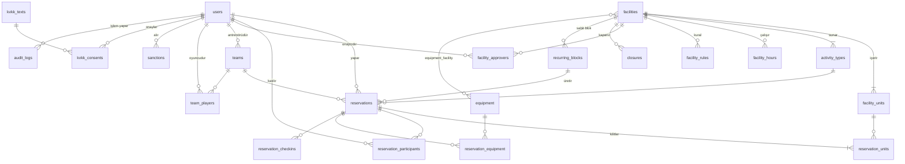

# Veritabanı Tasarımı

MySQL 8 (InnoDB, `utf8mb4`). Zaman damgaları uygulama saat dilimindedir (`Europe/Istanbul`).
🔒 işaretli sütunlar uygulama katmanında **AES-256-CBC + HMAC** (Laravel `encrypted` cast) ile şifrelenir.

## ER diyagramı

## Tablolar

### Kullanıcı ve yetki

**users**

| Sütun | Tip | Not |
|---|---|---|
| id | bigint PK | |
| username | varchar(100) unique | LDAP kullanıcı adı |
| ldap_dn | varchar(500) | |
| name, email | varchar | LDAP'tan |
| number | varchar(50) index | Öğrenci / personel no |
| department | varchar null | |
| base_role | enum(student, admin_staff, academic, alumni) | LDAP OU'sundan |
| is_coach, is_sks_admin, is_attendant | bool | SKS Admin atar |
| locale | enum(tr, en) | |
| is_active | bool | Pasif kullanıcı giriş yapamaz |
| last_login_at | datetime null | |

> Şifre sütunu yoktur. Kimlik doğrulama yalnızca LDAP'tadır.

**facility_approvers** — `facility_id`, `user_id` (birleşik PK)

**sanctions** — `user_id`, `reason`, `starts_at`, `ends_at`, `is_automatic`, `created_by`, `lifted_by`, `lifted_at`

**kvkk_texts** — `version` (unique), `body_tr`, `body_en`, `published_at`, `published_by`
**kvkk_consents** — `user_id`, `kvkk_text_id`, `accepted_at`, `ip_address`, `user_agent` (unique: user + text)

### Tesis

**facilities**

| Sütun | Tip | Not |
|---|---|---|
| name_tr, name_en, description_tr, description_en | | |
| slot_minutes | tinyint | 30 / 60 |
| capacity | smallint | |
| group_allowed | bool | |
| participant_list_required | bool | |
| cancel_deadline_hours | smallint | Geç iptal sınırı |
| allowed_roles | json | `["student","admin_staff","academic","coach","alumni"]` |
| checkin_token | char(40) unique | QR kodu içeriği; yeniden üretilebilir |
| is_active | bool | |

**facility_units** — `facility_id`, `name_tr`, `name_en`, `sort`

**activity_types** — `facility_id`, `name_tr`, `name_en`, `units_required`, `is_team`, `allowed_roles` (json), `is_active`

**facility_hours** — `facility_id`, `weekday` (1=Pzt…7=Paz), `is_closed`, `opens_at`, `closes_at` (unique: facility + weekday)

**facility_rules** — `facility_id`, `role` (null = tesis varsayılanı), `max_duration_minutes`, `max_per_day`, `max_per_week`,
`max_days_ahead`, `min_hours_before` — boş değer üst seviyeden devralınır (unique: facility + role)

**holidays** — `date` (unique), `name_tr`, `name_en`, `closed_from` (null = tam gün)

**closures** — `facility_id` (null = tüm tesisler), `starts_at`, `ends_at`, `reason`, `created_by`

**recurring_blocks** — `facility_id`, `team_id` null, `title`, `weekdays` (json), `start_time`, `end_time`, `starts_on`, `ends_on`,
`unit_ids` (json), `created_by`

### Rezervasyon

**reservations**

| Sütun | Tip | Not |
|---|---|---|
| code | varchar(20) unique | `YR-2026-000123` |
| facility_id, activity_type_id | FK | |
| user_id | FK null | 5 yıl sonra anonimleştirmede `null` olur |
| team_id | FK null | |
| recurring_block_id | FK null | Sabit bloktan üretildiyse |
| kind | enum(individual, group, team, block) | |
| status | enum(pending, approved, rejected, cancelled, expired) | |
| starts_at, ends_at | datetime | index |
| participant_count | smallint | |
| notes | text null | |
| decided_by, decided_at, rejection_reason | | Onay/red |
| cancelled_by, cancelled_at, cancel_reason, is_late_cancel | | İptal |
| attendance | enum(attended, no_show) null | |
| attendance_marked_by, attendance_marked_at | | Görevli düzeltmesi |
| approver_reminded_at, reminded_day_at, reminded_hours_at | datetime null | Zamanlanmış görevler için |
| anonymized_at | datetime null | |

İndeksler: `(facility_id, starts_at)`, `(status, starts_at)`, `(user_id, starts_at)`.

**reservation_units** — `reservation_id`, `facility_unit_id`, `starts_at`, `ends_at`, `is_active`
Çakışma sorgusu: aynı birimde `is_active = 1 AND starts_at < :bitis AND ends_at > :baslangic`.
`is_active`, rezervasyon reddedilince / iptal edilince / süresi dolunca `0` yapılır. Talep oluşturma işlemi
transaction içinde ilgili `facility_units` satırları `SELECT … FOR UPDATE` ile kilitlenerek yapılır (yarış durumu önlenir).

**reservation_participants** — `reservation_id`, `user_id`, `removed_at` (unique: reservation + user)

**reservation_checkins** — `reservation_id`, `user_id`, `method` (qr, attendant), `checked_in_at`

**equipment** — `name_tr`, `name_en`, `total_stock`, `is_active`; **equipment_facility** — `equipment_id`, `facility_id`

**reservation_equipment** — `reservation_id`, `equipment_id`, `quantity`, `delivered_at`, `delivered_by`, `returned_at`,
`returned_by`, `return_condition` (ok, damaged, missing), `note`

### Takım

**teams** — `name`, `sport`, `coach_id` (FK users), `is_active`

**team_players**

| Sütun | Tip | Not |
|---|---|---|
| team_id, user_id | FK | |
| jersey_no, position | | |
| birth_date 🔒, phone 🔒, license_no 🔒 | text | |
| health_report_date 🔒, health_report_expires_on 🔒 | text | |
| emergency_contact_name 🔒, emergency_contact_phone 🔒 | text | |
| notes 🔒 | text | |
| photo_path | varchar null | `storage/app/private` (web'den doğrudan erişilemez) |
| joined_on, left_on | date | |
| health_warned_at | datetime null | |
| sensitive_purged_at | datetime null | Takımdan çıkışta doldurulur |

### Sistem

**settings** — `key` (PK), `value` (json)

| Anahtar | Varsayılan |
|---|---|
| default_max_duration_minutes | 120 |
| default_max_per_day | 1 |
| default_max_per_week | 3 |
| default_max_days_ahead | 14 |
| default_min_hours_before | 2 |
| approver_reminder_after_hours | 4 |
| approver_reminder_before_start_hours | 2 |
| noshow_grace_minutes | 15 |
| checkin_early_minutes | 10 |
| sanction_threshold | 3 |
| sanction_window_days | 30 |
| sanction_duration_days | 14 |
| retention_years | 5 |
| health_warning_days | 30 |

**audit_logs** (yalnızca ekleme)

| Sütun | Not |
|---|---|
| id, created_at | |
| user_id | İşlemi yapan (sistem görevleri için null) |
| action | `auth.login`, `reservation.approved`, `player.viewed` … |
| subject_type, subject_id | |
| data | json — değişen alanlar (hassas değerler maskelenir) |
| ip_address, user_agent | |
| prev_hash, hash | `hash = HMAC-SHA256(APP_KEY, prev_hash ‖ kayıt)` — zincir `php artisan audit:verify` ile doğrulanır |

MySQL'de `audit_logs` için `UPDATE` ve `DELETE` işlemlerini engelleyen tetikleyiciler (trigger) migration ile kurulur.

## Saklama ve silme

| Veri | Süre | İşlem |
|---|---|---|
| Rezervasyon | Bitişten 5 yıl sonra | `user_id`, `notes`, katılımcılar, check-in'ler silinir; tesis/saat istatistik için kalır |
| Oyuncu hassas verileri | Takımdan çıkışta | 🔒 alanlar ve fotoğraf silinir |
| İşlem kaydı | Silinmez | Arşivleme politikası Bilgi İşlem ile belirlenir |
| Oturumlar | 30 dk hareketsizlik | Otomatik |
