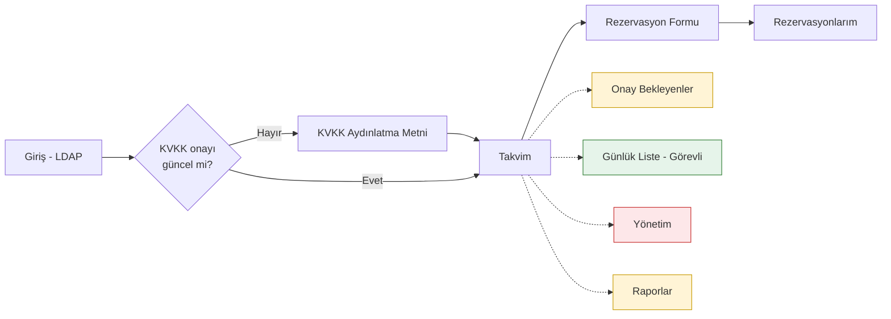

# Ekran Akışları

## Genel gezinme



Üst menü role göre değişir:

| Menü | Öğrenci / Personel / Mezun | Antrenör | Görevli | Tesis Onaycısı | SKS Admin |
|---|:-:|:-:|:-:|:-:|:-:|
| Takvim | ✔ | ✔ | ✔ | ✔ | ✔ |
| Rezervasyonlarım | ✔ | ✔ | ✔ | ✔ | ✔ |
| Takımlarım | | ✔ | | | |
| Günlük Liste | | | ✔ | | ✔ |
| Onay Bekleyenler (sayaç) | | | | ✔ | ✔ |
| Raporlar | | | | ✔ (kendi tesisleri) | ✔ |
| Yönetim | | | | | ✔ |
| TR / EN | ✔ | ✔ | ✔ | ✔ | ✔ |

## 1. Giriş

- Kullanıcı adı + şifre (LDAP). "Yaşar Üniversitesi hesabınızla giriş yapın."
- Hata mesajı genel tutulur ("Kullanıcı adı veya şifre hatalı"); hangi bilginin yanlış olduğu söylenmez.
- 5 hatalı denemeden sonra 1 dakika bekleme.

## 2. KVKK Aydınlatma Metni

- Kaydırılabilir metin (kullanıcının dilinde), "Okudum, onaylıyorum" kutusu, Onayla butonu.
- Onaylanmadan başka sayfaya geçilemez. Çıkış yapılabilir.

## 3. Takvim (ana ekran)

```
┌───────────────────────────────────────────────────────────────────┐
│ [Spor Salonu] [Dans Salonu] [Çalışma Odası 1] ...   (tesis sekmeleri)│
│ ◀  Cuma, 20 Kasım 2026  ▶   [Bugün]     Görünüm: (Gün) (Hafta)      │
├────────┬──────────────┬──────────────┬────────────────────────────┤
│ Saat   │   Pota A     │   Pota B     │                            │
├────────┼──────────────┼──────────────┤  Renkler:                  │
│ 08:00  │   [ Boş ]    │   [ Boş ]    │  ■ Boş (tıklanır)           │
│ 09:00  │  Beklemede   │   [ Boş ]    │  ■ Beklemede                │
│ 10:00  │  Onaylı      │  Onaylı      │  ■ Onaylı                   │
│ 11:00  │  Erkek Bsk. Antrenmanı (sabit blok)│  ■ Kapalı/geçmiş      │
│ ...    │              │              │  ■ Benim rezervasyonum      │
└────────┴──────────────┴──────────────┴────────────────────────────┘
```

- **Gün görünümü**: Sütunlar alt birimler, satırlar slotlar. Boş hücreye tıklayınca form o tesis, birim, tarih ve saatle açılır.
- **Hafta görünümü**: Sütunlar günler, satırlar slotlar; hücrede "2/2 boş", "1/2 boş", "Dolu".
- Başkalarının rezervasyonlarında kişi adı **gösterilmez** (yalnızca "Onaylı / Beklemede"); SKS ve onaycılar adı görür.
- Tatil, kapatma ve çalışma saati dışı hücreler gri ve açıklamalıdır.

## 4. Rezervasyon Formu

| Alan | Davranış |
|---|---|
| Tesis | Takvimden gelir, değiştirilebilir |
| Aktivite | Sadece kullanıcının rolüne izinli aktiviteler listelenir. Gereken birim sayısı yazar ("Tam salon – 2 pota") |
| Tarih, Başlangıç, Bitiş | Slot süresine göre seçenekler |
| Birim | 1 birim gereken aktivitede isteğe bağlı tercih; boşsa sistem seçer |
| Takım | Takım aktivitesinde zorunlu. Antrenör yalnızca kendi takımlarını görür |
| Katılımcılar | Katılımcı listesi zorunlu tesislerde: öğrenci/personel numaraları (her satıra bir tane) |
| Kişi sayısı | Liste zorunlu değilse elle girilir; kapasite gösterilir |
| Ekipman | Tesise tanımlı ekipmanlar ve adet |
| Not | İsteğe bağlı |

Gönderimde bölüm 5.2'deki kontroller yapılır. Hata olursa form, alan bazında açıklayıcı mesajla geri döner
(ör. "Bu tesis için haftalık 3 rezervasyon sınırına ulaştınız", "Ayşe Yılmaz (20231045) bu gün bu tesis için zaten bir rezervasyonda").
Başarılıysa: "Talebiniz alındı, SKS onayı bekleniyor. Kod: YR-2026-000123".

## 5. Rezervasyonlarım

- Sekmeler: **Yaklaşan** · **Geçmiş** · **Katılımcı olduklarım**
- Kart: kod, tesis, aktivite, tarih-saat, birimler, durum rozeti, ekipman, red gerekçesi
- İşlemler: **Geri çek** (beklemede), **İptal et** (onaylı; iptal süresi geçtiyse "Bu iptal geç iptal sayılacak" uyarısı),
  **Listeden çık** (katılımcı)
- Aktif yaptırım varsa üstte kırmızı şerit: "14.12.2026'ya kadar rezervasyon yapamazsınız (3 gelmeme)."

## 6. Onay Bekleyenler (Tesis Onaycısı / SKS Admin)

- Tablo: kod, talep zamanı, kişi (ad, no, rol), tesis, aktivite, tarih-saat, birimler, kişi sayısı, takım, ekipman, kalan süre
- Başlangıca yakın talepler üstte ve vurgulu
- Satırda: **Onayla** · **Reddet** (gerekçe zorunlu)
- Onaycı yalnızca kendi tesislerini görür; SKS Admin hepsini

## 7. Günlük Liste (Salon Görevlisi)

- Tesis seçimi + tarih (varsayılan bugün)
- Her rezervasyon: saat, kişi, kişi sayısı, check-in durumu, **Geldi / Gelmedi** düğmeleri
- Ekipman satırları: **Teslim et** · **Teslim al** (sağlam / hasarlı / kayıp + not)

## 8. QR Check-in

Kullanıcı tesis girişindeki QR'ı telefon kamerasıyla okutur → `/checkin/{kod}` açılır (oturum yoksa giriş istenir) →
"Giriş kaydedildi: Spor Salonu, 18:00–20:00" ya da "Şu an bu tesiste check-in yapılabilecek bir rezervasyonunuz yok."

## 9. Takımlarım / Takım Yönetimi

- Takım listesi → takım detayı: aktif oyuncular, eski oyuncular
- **Oyuncu ekle**: öğrenci numarası ile LDAP araması → bilgiler otomatik gelir → forma no, mevki ve hassas alanlar
- Oyuncu detayı (hassas alanlar): yalnızca antrenör ve SKS Admin; açılması işlem kaydına yazılır
- Sağlık raporu süresi dolanlar kırmızı, 30 gün içinde dolacaklar sarı
- **Takımdan çıkar**: onay penceresi "Sağlık ve iletişim bilgileri kalıcı olarak silinecek"

## 10. Yönetim (SKS Admin)

| Sayfa | İçerik |
|---|---|
| Tesisler | Liste → düzenle: genel ayarlar, alt birimler, aktiviteler, çalışma saatleri, rol kuralları, onaycılar, QR kodu (yazdır / yenile) |
| Sabit Bloklar | Yeni blok → **önizleme** (oluşacak tarihler, atlanan tatiller, çakışan rezervasyonlar) → onayla |
| Kapatmalar | Yeni kapatma → çakışan rezervasyonlar → iptal ederek kaydet |
| Resmi Tatiller | Yıl listesi, ekle / düzenle / sil, yarım gün |
| Takımlar | Takım ekle, antrenör ata, oyunculara git |
| Ekipman | Ad, stok, tesisler |
| Kullanıcılar | Arama; antrenör / SKS Admin / görevli rolleri; aktif-pasif; yaptırım ver / kaldır |
| Ayarlar | Bölüm 02'deki `settings` değerleri |
| KVKK Metni | Yeni sürüm yayımla (TR/EN); onay istatistiği |
| İşlem Kaydı | Filtre (kullanıcı, işlem, tarih); zincir doğrulama sonucu |

## 11. Raporlar

Filtre: tarih aralığı, tesis. Bölümler: Doluluk + ısı haritası, Kullanıcılar, Gelmeme/İptal, Onay Performansı, Takımlar, Ekipman.
Butonlar: **Excel indir** · **PDF indir**.
